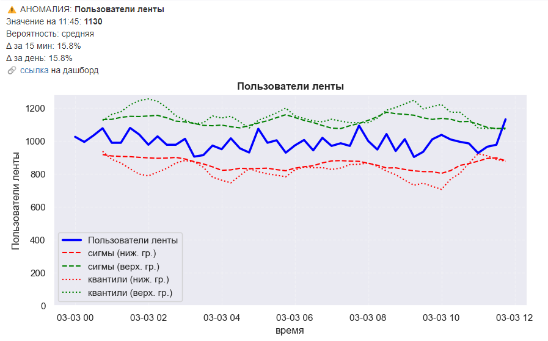

# Система алертов для мониторинга аномалий (Airflow + Telegram)

Учебный проект по разработке системы, которая проверяет ключевые метрики приложения и отправляет алерты в Telegram при обнаружении аномалий.

## Задача
Разработать систему мониторинга, которая с периодичностью **каждые 15 минут** проверяет ключевые метрики приложения (активные пользователи ленты и мессенджера, просмотры, лайки, CTR, количество отправленных сообщений).

**Основные требования:**
*   **Изучить поведение метрик** и подобрать наиболее подходящий статистический метод для детектирования аномалий.
*   **При обнаружении аномалии** отправить в чат сообщение, содержащее:
    *   название метрики;
    *   её текущее значение;
    *   величину отклонения.
*   **Дополнительная информация (опционально):** добавить в сообщение график с динамикой метрики и/или ссылку на дашборд в BI-системе для исследования причин.

## Особенности реализации
*   **Сбор данных:** SQL-запрос к ClickHouse, агрегация по 15-минутным интервалам.
*   **Детектирование аномалий:** Реализован **ансамбль из трёх статистических методов**:
    *   **1.** Сравнение с аналогичной 15-минуткой вчерашнего дня (diff).
    *   **2.** Метод квантилей (IQR) со скользящим окном.
    *   **3.** Правило трёх сигм (3-sigma) со скользящим окном.
*   **Оценка уверенности:** Система определяет вероятность аномалии (низкая, средняя, высокая) в зависимости от того, сколько методов сработало.
*   **Визуализация:** Строится график с текущей метрикой и доверительными интервалами (границы квантилей и сигм).
*   **Оповещение:** Отправка сообщения с метрикой, значением, отклонением, ссылкой на дашборд и графиком в Telegram.
*   **Автоматизация:** DAG в Airflow для запуска проверки каждые 15 минут.
*   **Безопасность:** Токены и пароли вынесены в переменные окружения (`.env`).

## Результат работы

**Пример алерта, отправленного в Telegram:**

## 📂 Файлы
*   **[IR_alert_dag.py](./IR_alert_dag.py)** — код DAG-а.
