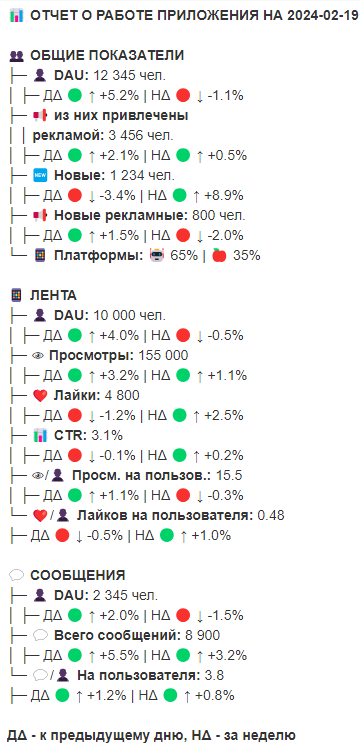
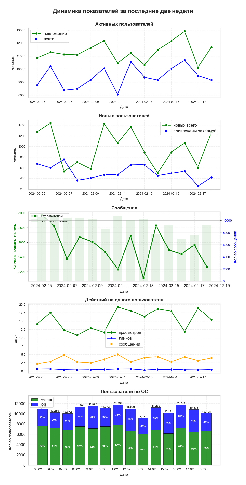

# Комплексный отчёт по работе приложения (Airflow + Telegram)

Учебный проект по автоматизации отчётности всего приложения (лента + мессенджер) с помощью Apache Airflow.

## Задача
Собрать отчёт по работе всего приложения как единого целого и автоматизировать его ежедневную отправку в Telegram в 11:00 по МСК.

**Требования к отчёту (из задания):**
> *Соберите отчет по работе всего приложения как единого целого. Продумайте, какие метрики необходимо отобразить в этом отчете? Как можно показать их динамику? Приложите к отчету графики или файлы, чтобы сделать его более наглядным и информативным. Отчет должен быть не просто набором графиков или текста, а помогать отвечать бизнесу на вопросы о работе всего приложения совокупно.*

## Особенности реализации
*   **Сбор данных:** SQL-запросы к ClickHouse.
*   **Текстовая часть:** Детальная сводка с расчётом отклонений (день к дню, неделя к неделе) и цветовой индикацией.
*   **Графическая часть:** 5 графиков:
    1.  **Активные пользователи** — сравнение приложения и ленты.
    2.  **Новые пользователи** — всего vs привлечённые рекламой.
    3.  **Сообщения** — количество отправителей (линия) и общее количество сообщений (столбцы) на двух осях.
    4.  **Действия на пользователя** — просмотры, лайки, сообщения.
    5.  **Пользователи по ОС** — стековая диаграмма с долями (Android/iOS).
*   **Автоматизация:** DAG запускается ежедневно в 08:00 по UT.
*   **Безопасность:** Токены и пароли вынесены в переменные окружения (`.env`).

## Результат работы
**Текстовая часть отчёта, отправленная в Telegram:**

**Графики с динамикой метрик за две недели:**

## 📂 Файлы
*   `IR_app_report_dag.py` — код DAG-а.
