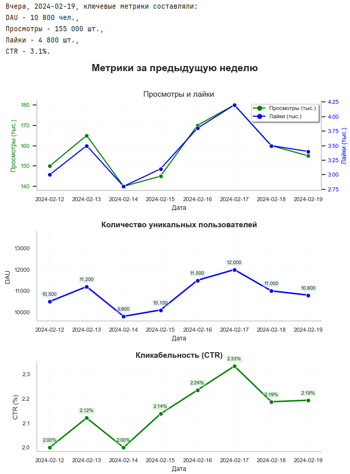

# Автоматический отчёт по ленте новостей (Airflow + Telegram)

Учебный проект по автоматизации базовой отчётности приложения с помощью Apache Airflow.

## Задача
Настроить ежедневную отправку аналитической сводки по ленте новостей в Telegram. *Отчет должен состоять из двух частей:*
> 1. *Текст с информацией о значениях ключевых метрик за предыдущий день.*
> 2. *График с значениями метрик за предыдущие 7 дней.*
Ключевые метрики: DAU, Просмотры, Лайки, CTR.

## Особенности реализации
*   **Сбор данных:** SQL-запрос к ClickHouse за последние 7 дней.
*   **Текстовая часть:** Формирование сводки за предыдущий день с округлением CTR до 2 знаков.
*   **Графическая часть:** Построение трёх графиков (2 из них с двумя осями Y):
    1.  **Просмотры и лайки** — совмещены на одном графике с разными осями для наглядности.
    2.  **DAU** — с подписями значений над точками.
    3.  **CTR** — с подписями в процентах.
*   **Автоматизация:** DAG запускается по расписанию `0 8 * * *` (каждое утро).
*   **Безопасность:** Токены и пароли вынесены в переменные окружения (`.env`).

**Пример отчёта (текст и графики), отправленного в Telegram:**

## 📂 Файлы
*   `feed_report_dag.py` — код DAG-а (токены и пароли заменены на переменные окружения).
